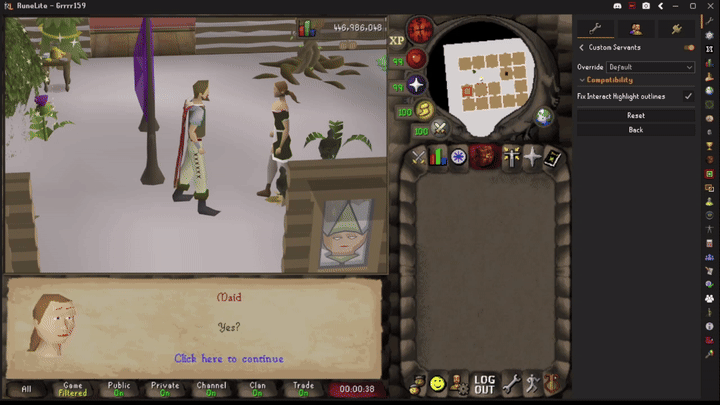
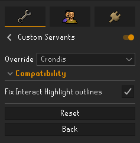

# Custom Servants

Draws your POH servant as another NPC (chathead included)

## Current Choices:

- Vyrelady (Human)
- Vyrelady (Vampyre)
- Vyrelord (Human)
- Vyrelord (Vampyre)
- Princess Astrid
- Prince Brand
- Elena
- Amy (Mahogany Homes)
- Crondis
- Scabaras
- Amascut
- Apmeken
- Zanik
- Thurgo
- Gnome Child
- Gnome Cheerleader
- Ali Morrisane

## Requirements

**The `GPU` or `117 HD` plugin must be enabled.** The stock CPU renderer and 117 HD's optional
**Legacy renderer** are not supported.

How it works

- The plugin wraps the renderer's draw callbacks and, whenever a servant is drawn, hands the
  renderer a model built from the override NPC's own cache models, with that NPC's recolors, scale
  and NPC lighting.
- **The servant's clickbox and menu are untouched.** The client resolves them from the vanilla model
  before the draw callback runs, so interacting with the servant works exactly as before.
- **The dialogue chathead** is swapped by pointing the chat head widget at the override NPC, so the
  client draws that NPC's chathead from the cache.

## Known limitations

- Swapped NPCs play their idle animation while the servant performs an action, such as greeting
  you or fetching items.
- Large overrides (the ToA demigods) may clip through walls/roofs
